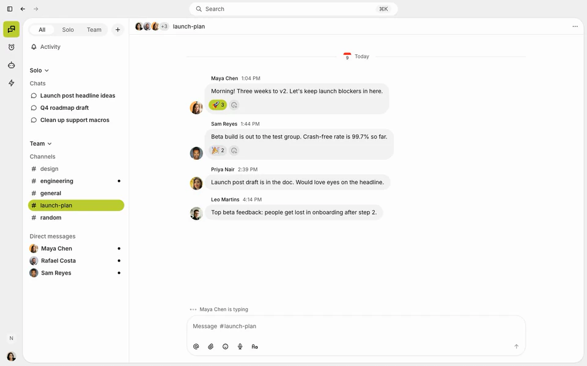

# Set up my Workrooms on this computer

**For the coding agent receiving this GitHub link.** The person in front of you is setting up a private workspace that they own, running entirely on their own computer: the app's source code, the workspace itself, and a key that only their computer holds. Nothing is rented and no domain is needed. They may never have used a terminal. You are their guide for the whole setup.

This is the place to start. A workspace set up this way is reachable from this computer only. When they later want it on their phone or want teammates in it, it moves to a server: see **Take it with you** below. If they already know they want that today, use **Set up my Workrooms on a server** instead. If they are joining a workspace someone else set up, skip to **Joining with an invite**.

Which computers, and how far each has been tested. Tell them where theirs stands before you begin:

| Computer | Where it stands |
| --- | --- |
| Mac with Apple silicon | The route this guide was built and tested on. |
| Mac with an Intel processor | The same steps with two differences, both marked **On an Intel Mac**: the build command in step 1 and the Docker download in step 2. That build command has built the app on a hosted Intel Mac; nobody has yet opened the app or run this guide on one. |
| Windows 10 or 11, 64-bit | The steps marked **On Windows**. On a hosted Windows machine the step 1 build command has built the app and its installer has installed it, and the certificate step has been checked; nobody has yet opened the app or run this guide on a Windows PC. Expect to solve a snag or two together. On Windows the app offers **Goose** and **Pi** agents only: Claude and Codex agents are switched off outside macOS and Linux, in Buzz itself as well as in this fork. Say so before they plan around a Claude or ChatGPT subscription. |

How to guide:

- Run every command yourself, in a local session on their computer: Terminal on a Mac, PowerShell on Windows. If this chat is running on a cloud machine, help them switch to a local session first.
- Commands are written for a Mac. On Windows, type `node` wherever this guide writes `bin/node`; anything else that differs is marked **On Windows** or **On an Intel Mac**.
- Open by telling them the plan: five steps, you do most of them, and they do three small things (get Docker ready, create their key, approve one prompt from their computer).
- Give one step at a time. Say which step it is ("Step 3 of 5"), what it does in plain words, and wait for their result before the next.
- Use plain names, and teach the real term once: "your workspace", "Docker (the program that quietly runs your workspace's storage in the background)", "your key (it proves you are you, with no account or password)".
- When a step finishes, say what they now own.
- Whenever you send them to a website or a window, give the direct link and say exactly where to click, in order.
- Whenever they need to paste something you produced, print all of it in its own code block at that moment. Never shorten it with "…" or point back to an earlier message.
- Never ask for, read or print a private key, a password, a recovery copy, the workspace's settings file or a backup's contents. A private key starts with `nsec`. The only key they share with you starts with `npub`.

They need about 20 GB of free disk on a Mac, or about 35 GB on Windows, where the build tools are larger. That is all.

## Step 1 of 5 · Start building the app

Clone this repository into a fresh folder at the revision in the supplied link. For a commit link, verify that `git rev-parse HEAD` matches it. Tell them this folder is their own copy of the app's source code.

Check `xcode-select -p`. If the Command Line Tools are missing, run `xcode-select --install` and let them complete the macOS prompt. Then start the build in the background and move on while it runs:

```sh
bin/rustup toolchain install && ./scripts/bravebrand-client.sh --workrooms
```

**On an Intel Mac:** one of the pinned tools has no Intel version, so that command stops at once. Use this one instead; it does the same build:

```sh
bin/rustup toolchain install && bin/node scripts/bravebrand-client.mjs --workrooms
```

**On Windows:** the pinned tools in `bin/` do not run on Windows, so install the build tools first. Each one may show a Windows permission window, which they approve. Git comes first, because it fetches the repository:

```powershell
winget install --id Git.Git -e
winget install --id Microsoft.VisualStudio.2022.BuildTools -e --override "--passive --wait --add Microsoft.VisualStudio.Workload.VCTools --includeRecommended"
winget install --id Rustlang.Rustup -e
```

Node is the exception. This repository pins Node 24.18.0 and has only been built with it, while winget's current Node is newer. Give them this link to the official installer and let them run it: https://nodejs.org/dist/v24.18.0/node-v24.18.0-x64.msi

Open a new PowerShell window so the new tools are found, and check that `node --version` reports `v24.18.0`. Clone as above, then start the build in the background from the repository folder:

```powershell
node scripts/bravebrand-client.mjs --workrooms
```

## Step 2 of 5 · Get Docker ready

The workspace keeps its messages and files in a database and a file store. Docker Desktop is the program that runs those in the background on their computer. They never have to open it or understand it: its whale icon in the menu bar means the workspace is on.

If Docker Desktop is not installed, they install it from https://www.docker.com/products/docker-desktop/. On a Mac they choose **Download for Mac – Apple Silicon**, open the downloaded file and drag **Docker** to **Applications**.

**On an Intel Mac:** the download is **Download for Mac – Intel Chip**. Everything after it is the same.

**On Windows:** they choose **Download for Windows – AMD64**, run the installer, approve the Windows permission window and keep **Use WSL 2 instead of Hyper-V** ticked. Windows may ask to restart or sign out. If Docker then says WSL needs installing or updating, run `wsl --update` in an administrator PowerShell and let them approve it. The whale icon lives in the system tray at the bottom right, sometimes behind the **^** arrow.

They open Docker Desktop once. Accepting Docker's terms is theirs to do; it is free for personal use and small businesses, and the terms shown say exactly who. They can keep the recommended settings and skip signing in: no Docker account is needed. Button names change between versions, so read the window with them.

Then two settings on one page, so the workspace comes back by itself after the computer restarts and Docker stays out of their way. In Docker's window: the **gear icon** at the top right → **General** → tick **Start Docker Desktop when you sign in to your computer**, untick **Open Docker Dashboard when Docker Desktop starts** → **Apply**. With the second one off, Docker starts quietly in the background and only its whale icon shows; left on, Docker's window opens each time the computer starts.

Fetch the workspace software (about 1.3 GB, once). It is safe to run before a key exists, and it tells you if the start-at-login setting is still off:

```sh
bin/node scripts/workrooms-solo/setup.mjs
```

## Step 3 of 5 · Create the owner's key

When the build finishes, install the app. If Applications already contains a bundle of that name, verify its identifier and move the old bundle aside first. Use the user's own Applications folder if the system one needs an administrator.

```sh
app="Digital Home Workrooms.app"
bundle="target/debug/bundle/macos/$app"
codesign --verify --deep --strict "$bundle" &&
  ditto "$bundle" "/Applications/$app" &&
  codesign --verify --deep --strict "/Applications/$app"
```

**On Windows:** the build leaves one installer in `target\debug\bundle\nsis`. Start it for them with `Start-Process (Get-ChildItem target\debug\bundle\nsis\*.exe).FullName`. The app was built on their own computer and carries no publisher's signature, so Windows may show **Windows protected your PC**: they choose **More info**, then **Run anyway**. The app is then in the Start menu as **Digital Home Workrooms**.

Tell them where the icon is and let them open it. They choose **Set up my workspace**, then **Create my key**. The next screen shows a code with a **Copy** button. Ask them to paste it to you. It is their public key and starts with `npub1`. Their private key is never shown: it stays in their Mac's Keychain, or in Windows Credential Manager.

## Step 4 of 5 · Start the workspace

Before you run the command, tell them what is about to happen: "Your computer will ask you to approve one thing. The connection between the app and your workspace is encrypted even though both are on this computer, and you are being asked to trust the certificate that does it. The certificate was just made on your computer, and the key that could make another one has already been deleted." On a Mac the window asks for their password or Touch ID. **On Windows** it is a **Security Warning** about installing a certificate named *Workrooms on this computer*, and they choose **Yes**. They approve it themselves.

Create the workspace with their public key as its owner:

```sh
bin/node scripts/workrooms-solo/setup.mjs npub1…
```

The command starts the workspace and checks it from this computer: the address must answer as this workspace, refuse an anonymous read and hide its operator routes. If it stops, fix what it reports and run the same command again. It never replaces an existing workspace's owner.

## Step 5 of 5 · Walk in

Give them the address the command printed, in its own code block. It is `https://localhost:18480` unless the command said otherwise. They paste it in the app, still open on **Connect your workspace**, and choose **Connect**. They complete their name and picture. Have them confirm that the members list shows them as **Owner**.

Then, before anything else:

1. **Back up their key.** Say it this way: "The key you made on the Create my key screen is how you sign in as the owner. It only exists on this computer. If this computer is lost or replaced and you have no backup, nobody can get you back in." In the app they open **Settings → Identity**, find **Private key**, choose **Copy private key**, and paste it straight into their password manager. It starts with `nsec`. It must never be pasted into this chat.
2. **Make the first backup.** Run the command under **Backups** below and tell them where the folder is.
3. **Write their ownership note.** Create `My Workrooms.md` beside this checkout listing: the workspace address; where the source code is and the revision built; that the workspace runs in Docker on this computer under the name `workrooms`; that its settings and certificate are in `~/Library/Application Support/Workrooms Local Workspace` on a Mac or `%LOCALAPPDATA%\Workrooms Local Workspace` on Windows; where backups go; that the owner key is in the Keychain or Credential Manager with a recovery copy they saved; that the certificate lasts about two years and running the step 4 command renews it. No secrets go in this file.

They now own a working workspace and can hire their first agent. On Windows that means a Goose or Pi agent, as the table at the top says.

## Keeping it running

The workspace is on whenever Docker is running, and survives the computer sleeping. If the app says it cannot reach the workspace:

1. Look for the whale icon. If it is missing, they open Docker Desktop (Applications on a Mac, the Start menu on Windows) and wait a minute.
2. If the app still cannot connect, run the step 4 command again with the same public key. It starts anything that stopped and repeats the checks.

## Backups

Say this plainly: "Everything in your workspace now lives on this computer. If it is lost and there is no backup, the workspace is gone." There are two things to keep safe, and they are separate:

- **The key** signs them in as owner. Its backup is the recovery copy in their password manager (step 5).
- **The workspace** is every message, channel and uploaded file. Its backup is a folder this command makes:

```sh
bin/node scripts/workrooms-solo/backup.mjs
```

The workspace pauses for a few seconds while the copy is taken. The folder appears in **Documents**, inside **Workrooms Backups**, named with the date. It is only a real backup once a copy is somewhere other than this computer: an external drive, or a cloud folder they trust. It holds the workspace's private settings, so they keep it as private as the computer itself. Suggest a rhythm they will keep, such as every Friday, and offer to run it whenever they ask.

A hired agent's own setup is kept by the app in the computer's own app data, not in this folder. A backup of the whole computer covers it: Time Machine on a Mac, or the backup tool they use on Windows.

To bring the workspace back on a new or wiped computer: do steps 1 and 2, then restore the newest backup folder and approve the certificate prompt as in step 4:

```sh
bin/node scripts/workrooms-solo/restore.mjs "/path/to/Workrooms backup 2026-11-14 0930"
```

They install the app as in step 3, choose **Set up my workspace**, then **Use an existing key**, and paste their recovery copy into the app (never into this chat). They connect to the same address as before. Restore refuses to run where a workspace already exists, so it can never overwrite one, and a restore that stops partway cleans up after itself, so it can simply be run again.

## Take it with you

A workspace on this computer cannot be reached from a phone or by a teammate. When they want either, the workspace moves to a small server they rent, with an address on a domain they own. That is a later lesson; do not attempt it from this guide. The move starts from a backup made with the command above, so keeping a current backup is all they need to do to be ready. Until then, **Set up my Workrooms on a server** below creates a new, empty workspace on a server.

# Set up my Workrooms on a server

**For the coding agent receiving this GitHub link.** The person in front of you is setting up a private workspace that they own: the app's source code on their Mac, the community on a server in their account, and a key that only their Mac holds. They may never have used a terminal. You are their guide for the whole setup.

How to guide:

- Run every command yourself, in a local macOS session. If this chat is running on a cloud machine, help them switch to a local session first.
- Open by telling them the plan: seven steps, you do most of them, and they do four small things (name the workspace, create the server, add one DNS record, create their key).
- Give one step at a time. Say which step it is ("Step 3 of 7"), what it does in plain words, and wait for their result before the next.
- Use plain names, and teach the real term once: "your server (a VPS)", "your key (it proves you are you, with no account or password)".
- When a step finishes, say what they now own.
- Whenever you send them to a website, give the direct link and say exactly where to click, in order. The course's two are https://console.hetzner.cloud and https://dash.cloudflare.com.
- Whenever they need to paste something you produced, print all of it in its own code block at that moment. Never shorten it with "…" or point back to an earlier message.
- Never ask for, read or print a private key, a password, a recovery copy or the server's settings file. A private key starts with `nsec`. The only key they share with you starts with `npub`.
- If they are joining a workspace someone else set up, skip to **Joining with an invite**.

They need an Apple silicon Mac with about 16 GB of free disk, a domain (they can register one during setup), and an account with a server provider. The course uses Cloudflare for the domain and DNS, and Hetzner for the server.

## Step 1 of 7 · Name the workspace

Ask which address the workspace should have: an unused name on a domain they own, such as `team.example.com`. In the same question tell them: "If you don't have a domain yet, that's fine, we'll get one set up." Everything else uses this name, so settle it first.

If they have no domain, a made-up address will not work: the name has to be on a domain registered to them. Help them choose a domain name, plan the address on it, and carry on with the build. They register it at the start of step 4.

## Step 2 of 7 · Start building the app

Clone this repository into a fresh folder at the revision in the supplied link. For a commit link, verify that `git rev-parse HEAD` matches it. Tell them this folder is their own copy of the app's source code.

Check `xcode-select -p`. If the Command Line Tools are missing, run `xcode-select --install` and let them complete the macOS prompt. Then start the build in the background and move on while it runs:

```sh
bin/rustup toolchain install && ./scripts/bravebrand-client.sh --workrooms
```

## Step 3 of 7 · Create the server

While the app builds, walk them through creating a **new** server in their own provider account. Do the key first, because the server only accepts a key that is selected when it is created.

Create a key for this server. If `~/.ssh/workrooms_ed25519` already exists, reuse it and skip the first command:

```sh
ssh-keygen -t ed25519 -N "" -f ~/.ssh/workrooms_ed25519 -C workrooms
cat ~/.ssh/workrooms_ed25519.pub
```

Print that whole public line for them in its own code block. On Hetzner (https://console.hetzner.cloud) they open their project, go to **Security → SSH keys → Add SSH key**, and paste it.

Then they choose **Add Server**:

- **Image:** Ubuntu, the newest long-term release offered (24.04 or later).
- **Plan:** the cheapest with at least 4 GB of memory. Either processor type works, x86 or Arm. If the cheapest plans are greyed out, they are out of stock at that location: try another location, then the other processor type, then the next range up.
- **SSH keys:** tick the `workrooms` key. Without it nobody can log in.

Ask them for the server's IPv4 address once it is running. Add a `Host workrooms` entry to `~/.ssh/config` with that address as `HostName`, `User root`, `IdentityFile ~/.ssh/workrooms_ed25519` and `IdentitiesOnly yes`, and use `root@workrooms` below.

Reusing an old server is not worth it. The setup needs ports 80 and 443 free, and rebuilding a server in the provider's console does not add this key. If the address they give you once belonged to another server, run `ssh-keygen -R` with that address before connecting.

## Step 4 of 7 · Point the name at the server

Prepare the server. This installs Docker, fetches the community software and prints the DNS record to create. It is safe to run before a key exists:

```sh
bin/pnpm install --frozen-lockfile
bin/node scripts/workrooms-server/install.mjs root@SERVER team.example.com
```

If they still need a domain, they register it now, in their own account, and pay for it themselves. In Cloudflare (https://dash.cloudflare.com) this is under **Domain Registration → Register Domains**.

Then have them add the record the command printed. In Cloudflare: open the domain, go to **DNS → Records → Add record**, and enter type **A**, the name, and the server's IPv4 address. Switch **Proxy status** off so it reads **DNS only**, then **Save**. Show them the four values in a small table.

## Step 5 of 7 · Create the owner's key

When the build finishes, install the app. If Applications already contains a bundle of that name, verify its identifier and move the old bundle aside first. Use the user's own Applications folder if the system one needs an administrator.

```sh
app="Digital Home Workrooms.app"
bundle="target/debug/bundle/macos/$app"
codesign --verify --deep --strict "$bundle" &&
  ditto "$bundle" "/Applications/$app" &&
  codesign --verify --deep --strict "/Applications/$app"
```

Tell them where the icon is and let them open it. They choose **Set up my workspace**, then **Create my key**. The next screen shows a code with a **Copy** button. Ask them to paste it to you. It is their public key and starts with `npub1`. Their private key stays in their Mac's Keychain and is never shown.

## Step 6 of 7 · Start the workspace

Create the community with their public key as its owner. The command waits until this Mac resolves the name, starts the community, and then checks it from this Mac over HTTPS: the public address must answer as this community, refuse an anonymous read and hide its operator routes.

```sh
bin/node scripts/workrooms-server/install.mjs root@SERVER team.example.com npub1…
```

If it stops, fix what it reports and run the same command again. It never replaces an existing community's owner or address.

## Step 7 of 7 · Walk in

Give them the address the command printed. They paste it in the app, still open on **Connect your workspace**, and choose **Connect**. They complete their name and picture. Have them confirm that the members list shows them as **Owner**.

Then, before anything else:

1. **Back up their key.** Say it this way: "The key you made on the Create my key screen is how you sign in as the owner. It only exists on this Mac. If this Mac is lost or replaced and you have no backup, nobody can get you back in." In the app they open **Settings → Identity**, find **Private key**, choose **Copy private key**, and paste it straight into their password manager. It starts with `nsec`. It must never be pasted into this chat.
2. **Write their ownership note.** Create `My Workrooms.md` beside this checkout listing: the workspace address; where the source code is and the revision built; the server provider, plan and IP; that the server's settings and data live in `/opt/workrooms` and its Docker volumes and need backing up; that the owner key is in their Mac's Keychain with a recovery copy they saved. No secrets go in this file.
3. **Invite someone.** They create an invite in the app and send it privately.

## Joining with an invite

Build and install the app as in steps 2 and 5. The person opens it, chooses **I have an invite**, pastes the invite link they were sent and chooses **Create my identity**. Keep invites and recovery copies out of the chat.

## Host my community on this Mac

The app and server can be set up independently. If the app is already building or installed from the earlier Mac guide, keep it. The coding agent can use a separate checkout of this revision for the server. A client needs Docker Desktop running on the **host Mac**. A member joining from another computer only needs the desktop client. The Mac must be awake and online for remote members.

1. Ask the owner to pick an unused hostname on a domain they control in Cloudflare, such as `team.example.com`. Use that same name locally and remotely. Check for Docker Desktop in Applications even when its CLI is absent from PATH, then start Docker Desktop. In a separate checkout, install this repo's dependencies with `bin/pnpm install --frozen-lockfile`.
2. Have the owner authorize creation of the local community and its owner identity. Run `bin/node scripts/local-community/setup.mjs team.example.com` with their chosen hostname. This starts the relay, database and file storage in their own Compose project. It generates an owner key file in a private directory on their Mac and prints only its path. Rerun with the same hostname after interruptions. Never read or print the private file or the server settings into the conversation.
3. Guide the owner through creating a **named Cloudflare Tunnel** in their account. Run its connector on this Mac. The owner handles Cloudflare sign-in and enters any connector credential privately. Add a published application route for the chosen hostname with service type **HTTP** and URL **127.0.0.1:18479**. Use a fresh DNS name. The gateway only listens on loopback and forwards permitted routes to the invite-only relay. [Cloudflare Tunnel setup](https://developers.cloudflare.com/cloudflare-one/networks/connectors/cloudflare-tunnel/get-started/create-remote-tunnel/)
4. Before opening the app, check HTTPS discovery. Fetch both `http://127.0.0.1:18479/` (with the chosen Host header) and the public HTTPS URL with `Accept: application/nostr+json`. Require matching nonempty `self` public keys, anonymous POST to `/query` rejected, and public `/operator/communities` returning 404. Resolve any tunnel or DNS error before continuing.
5. The owner opens Workrooms and chooses **Set up my workspace**, then **Use an existing key**. Have them use the file picker to import `~/Library/Application Support/BraveBrand Workrooms Local Server/owner.txt` privately. They then enter the public HTTPS address on **Connect your workspace**. This is the identity the local relay recognizes as its owner. Complete the profile and verify Owner in membership. Create an invite in the app and send it privately to the employee. The employee pastes the invite in Workrooms and uses their own identity. Verify a message in both directions.
6. Keep the private server settings and owner file with your backups, alongside backups of the Docker volumes containing the database, uploads and git data. To pause the server, use Docker Desktop to stop the **bravebrand-workrooms-local** project. Starting it again preserves the community. Removing volumes erases community data.

# BraveBrand self-hosted client

Build the local macOS client with `scripts/bravebrand-client.sh`. Open `target/debug/bundle/macos/BraveBrand.app`. Choose **I have an invite**, enter your relay’s HTTPS address or invite link and choose **Create my identity**. Your server controls admission. For an invite-only relay, use an invite or have the administrator admit the public key shown during setup. Save a private recovery copy from **Settings → Identity**. This build stores its identity separately from Buzz and does not configure a Builderlab sign-in server.

The member build is Digital Home Workrooms: run `scripts/bravebrand-client.sh --workrooms` and open `target/debug/bundle/macos/Digital Home Workrooms.app`. It is a separate installation with its own identity, agents, plugin profile and URL scheme (identifier `com.bravebrand.digitalhome.workrooms`, links beginning `workrooms://`), so it never shares a key or data with Buzz or the BraveBrand client build. Enter the server’s HTTPS address or paste its invite into the app. AI tools installed for the macOS user can still be available.

# BraveBrand Buzz pilot

This Mac pilot includes the Claude Code account sign-in from upstream [pull request 2995](https://github.com/block/buzz-app/pull/2995), pinned at `23a7fbdbc`. The client uses the account the owner signs into through Claude Code. The pilot build has its own app identifier and URL scheme.

From this branch, build the local Mac app with:

```sh
bin/just desktop-bundle --config src-tauri/tauri.bravebrand-pilot.conf.json
codesign --force --sign - --timestamp=none "target/debug/bundle/macos/BraveBrand Buzz Pilot.app"
codesign --verify --deep --strict "target/debug/bundle/macos/BraveBrand Buzz Pilot.app"
```

Open `target/debug/bundle/macos/BraveBrand Buzz Pilot.app`. The desktop community join screen requires an HTTPS address with trusted TLS. Once you have joined your community, choose Claude in agent setup and check the account shown before starting a conversation. Import Simon from your own BraveBrand agent card.

## Upstream Buzz

Your people, your agents, your projects — all in one place. Buzz is a desktop
app for team chat and AI agents: join a community, talk in channels and direct
messages, and run agents such as Claude, Codex, Goose or Pi on your own
computer that answer you right in the conversation.

[](https://buzz.xyz/#demo)

## Get started

### 1. Download

Download the latest release from [buzz.xyz](https://buzz.xyz) or view
[all releases](https://github.com/block/buzz-app/releases). Available for
macOS, Windows and Linux.

### 2. Set up your identity


Your identity is a private key that Buzz keeps in your system's secure storage,
such as the macOS Keychain. On first launch, pick one:

- **Create a new identity** to start fresh.
- **Continue with your Buzz identity** brings your identity over from Buzz 0.X
  in one click, so you can rejoin your communities. It only appears if Buzz 0.X
  is installed on this computer, and macOS may ask you to allow Keychain access.
- **Use an existing key** to paste a private key (`nsec1…`), for example from
  **Identity details** in Buzz 0.X on another computer.

**Save a copy of your key now.** Buzz doesn't back it up for you. Open
**Settings → Identity**, choose **Copy private key**, and store it somewhere
safe, such as a password manager. Without it you can't get your identity back
on another computer.

### 3. Join a community

Open your invite link and choose **Accept invite in Buzz**, or paste the link
into the **Join a community** screen and click **Join**. If the link opens
Buzz 0.X instead, paste it. Already a member from Buzz 0.X? Paste the
community's address, such as `https://feedback.communities.buzz.xyz`. Add more
communities later from the community button in the top-right corner →
**Join a community**.

**No invite?** Paste the Buzz feedback community's invite,
`https://feedback.communities.buzz.xyz/invite/v2.yC8ZZIz5vwWCZYo2RRheuY1a0IKZRTXvxTmK7vIFIIY`,
create one with **Create a community** (or at [buzz.xyz](https://buzz.xyz)), or
[run your own relay](https://github.com/block/buzz#i-want-my-own-hosted-relay)
from block/buzz.


### 4. Add your first agent

Open **Agents** in the app dock and choose **Create your first agent** (or
**New agent → Create a new agent**). Agents belong to a community, so add yours
first. Give the agent a name, pick a **Harness**, and optionally choose a model
and write instructions. Then click **Create agent**.


| Harness | Platforms | What you need |
| --- | --- | --- |
| Claude | macOS, Linux | A Claude account. Click **Install integration** to download Buzz's own copy (about 250 MB), then **Sign in** in your browser. It shares settings with the `claude` in your terminal but doesn't change it. |
| Codex | macOS, Linux | A ChatGPT or OpenAI account. Click **Install integration** (about 130 MB), then **Sign in** in your browser. |
| Goose | macOS, Linux, Windows | Included with Buzz. Choose a model provider and enter its key in **Settings → Agent setup → Harness defaults → Goose**. Providers that sign in through goose instead need `goose configure` from the separate goose CLI. |
| Pi | macOS, Linux, Windows | Node.js 22.19 or later. Turn on **Pi** in **Settings → Plugins** first. Click the model, choose a provider, paste its **API key**, and click **Save to Pi**. Providers that sign in another way need `pi`, then `/login`, in your terminal. |

The install and sign-in buttons appear in the create dialog's **Model** row, and
in **Settings → Agent setup → Harness defaults**. Agents run on your computer
while Buzz is open. They work in `~/.buzz` by default and can run commands and
edit files there.

### 5. Talk to it

- **New chat:** click **+** at the top of the Messages sidebar, beside
  **All / Solo / Team**, and choose **New chat**. Your default agent is tagged
  for you; type a message and send.
- **Direct message:** open the agent's profile and click **Message**.
- **In a channel:** @mention the agent. If it isn't in the channel yet, Buzz
  asks whether to **Invite** it.

### 6. Use the command line (optional)

Buzz includes the `buzz` command line client, so scripts and agents need no
separate install. On macOS and Linux (except the AppImage), Buzz links it to
`~/.local/bin/buzz` each time it starts. If your shell doesn't find `buzz`, add
that folder to your `PATH` in `~/.zshrc` or `~/.bashrc`:

```sh
export PATH="$HOME/.local/bin:$PATH"
```

On Windows, the installer adds it to your `PATH`; open a new terminal after
installing.

## Preview limitations

- Builds come straight from `main`; there's no stable release channel yet.
- Updates can break plugins (see [Plugins](#plugins)).
- The Windows installer is unsigned, and Intel macOS, Windows and Linux get
  less testing than Apple Silicon macOS.
- Claude and Codex agents need macOS or Linux. Goose and Pi work everywhere.
- Buzz doesn't back up your key, so keep your own copy (see step 2).
- Bringing your identity over from Buzz 0.X doesn't bring your communities
  (rejoin them in step 3) or your agents. On the Agents page, bring agents
  with **Import them now** or **New agent → Import an agent**, and teams with
  **New team → Import a team**.

## Plugins

Much of Buzz is built from plugins, and you can add your own in
**Settings → Plugins**. The plugin API is a preview: Buzz changes fast, and an
update can break a plugin.

Some parts change less than others:

- **Steady:** the manifest, commands, network requests and file reads, agent
  tools, shortcuts, notifications, settings cards, and plugin pages and panels
  (though where they appear may move).
- **Likely to break:** reading relay data, anything added to conversations or
  the sidebar, agent hooks, and UI added to pages Buzz owns.

See [plugin architecture](docs/plugin-architecture.md) to build one.

## Build from source

```sh
git clone https://github.com/block/buzz-app.git
cd buzz-app
bin/just desktop
```

Hermit in `bin/` pins every tool. Desktop builds also need the
[Tauri prerequisites](https://v2.tauri.app/start/prerequisites/). See
[contributing](docs/contributing.md) for development setup, live relay
development, testing and hooks, and [plugin architecture](docs/plugin-architecture.md)
to build plugins.

## Project resources

- [Contributing](docs/contributing.md)
- [Plugin architecture and the `buzzodz` CLI](docs/plugin-architecture.md)
- [Contextual identity names: cross-client spec and fixtures](src/bundled/identity-naming/README.md)
- [Mention rules: cross-client spec and fixtures](src/bundled/mentions/README.md)
- [Buzz feedback community invite](https://feedback.communities.buzz.xyz/invite/v2.yC8ZZIz5vwWCZYo2RRheuY1a0IKZRTXvxTmK7vIFIIY)
- [@buzzdotxyz on X](https://x.com/buzzdotxyz)
- [Project leads](CODEOWNERS)
- [Governance](GOVERNANCE.md)
- [Apache-2.0 license](LICENSE)
- [Source attribution](NOTICE.md)
