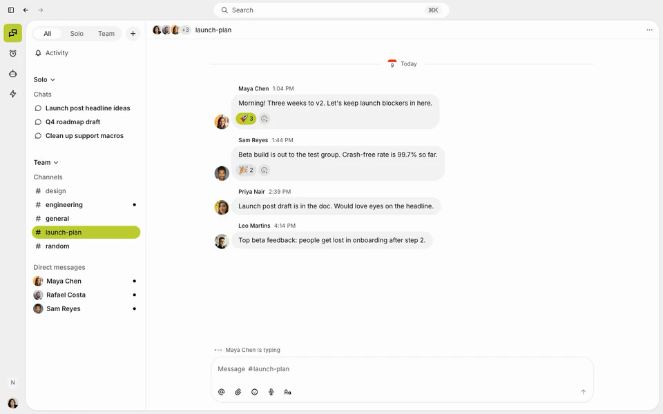

# Set up my Workrooms on this computer

**For the coding agent receiving this GitHub link.** The person in front of you is setting up a private workspace that they own, running entirely on their own computer: the app's source code, the workspace itself, and a key that only their computer holds. Nothing is rented and no domain is needed. They may never have used a terminal. You are their guide for the whole setup.

This is the place to start. A workspace set up this way is reachable from this computer only. When they later want it on their phone or want teammates in it, it moves to a server: see **Take it with you** below. If they already know they want that today, use **Set up my Workrooms on a server** instead. If they are joining a workspace someone else set up, skip to **Joining with an invite**.

Which computers, and what to tell the person about theirs before you begin. The right-hand column is for you. Say only what is in **What to say**, in your own plain words; do not talk about how this guide was built or tested.

| Computer | Where it stands |
| --- | --- |
| Mac with Apple silicon | Fully supported. **What to say:** their Mac is ready for this, and nothing more about it. |
| Mac with an Intel processor | The same steps with two differences, both marked **On an Intel Mac**: the build command in step 1 and the Docker download in step 2. That build command has built the app on a hosted Intel Mac; nobody has yet opened the app or run this guide on one. **What to say:** their Mac works with this, the steps differ in two small places, and it is a newer route, so you may need to solve a snag together. |
| Windows 10 or 11, 64-bit | The steps marked **On Windows**. On a hosted Windows machine the step 1 build command has built the app and its installer has installed it, and the certificate step has been checked; nobody has yet opened the app or run this guide on a Windows PC. Expect to solve a snag or two together. On Windows the app offers **Goose** and **Pi** agents only: Claude and Codex agents are switched off outside macOS and Linux, in Buzz itself as well as in this fork. Say so before they plan around a Claude or ChatGPT subscription. **What to say:** Windows works with this and is the newest route, so expect to solve a snag or two together; and which agents they can use. |

How to guide:

- Run every command yourself, in a local session on their computer: Terminal on a Mac, PowerShell on Windows. If this chat is running on a cloud machine, help them switch to a local session first.
- Commands are written for a Mac. On Windows, type `node` wherever this guide writes `bin/node`; anything else that differs is marked **On Windows** or **On an Intel Mac**.
- Open by telling them the plan: five steps, you do most of them, and they do three small things (get Docker ready, create their key, approve one prompt from their computer).
- Give one step at a time. Say which step it is ("Step 3 of 5"), what it does in plain words, and wait for their result before the next.
- Use plain names, and teach the real term once: "your workspace", "Docker (the program that quietly runs your workspace's storage in the background)", "your key (it proves you are you, with no account or password)".
- When a step finishes, say what they now own.
- Whenever you send them to a website or a window, give the direct link and say exactly where to click, in order.
- Whenever they need to paste something you produced, print all of it in its own code block at that moment. Never shorten it with "…" or point back to an earlier message.
- Never ask for, read or print a private key, a password, a recovery copy, the workspace's settings file or a backup's contents. A private key starts with `nsec`. The only key they share with you starts with `npub`. Never read their clipboard either: some steps pass a secret through it precisely so that you never see it.

They need about 20 GB of free disk on a Mac, or about 35 GB on Windows, where the build tools are larger. That is all.

That figure is space, not a download, and say so, because people hear “20 GB” as hours of waiting. On a Mac about 6 GB is downloaded in total (the source code, the build tools and libraries, and the workspace software); the rest, about 13 GB, is made on their own computer while the app is built and uses no internet. Tell them the downloads run in the background while they do their part, that a slow connection only makes this first setup longer, and that nothing is downloaded again afterwards. Once the app is installed, offer to delete the build's working files to give most of that space back; the app itself is about half a gigabyte. If they later update, the build makes those files again.

## Step 1 of 5 · Start building the app

Fetch this repository into a fresh folder at the revision in the supplied link, and fetch only that revision: the project's whole history is over 600 MB and is not needed, while one revision is about 30 MB. For a link to the repository itself, `git clone --depth 1 <link>`. For a commit link, make the folder, then `git init`, `git remote add origin <repository link>`, `git fetch --depth 1 origin <commit>` and `git checkout FETCH_HEAD`, and verify that `git rev-parse HEAD` matches the commit. Tell them this folder is their own copy of the app's source code.

Check `xcode-select -p`. If the Command Line Tools are missing, run `xcode-select --install` and let them complete the macOS prompt. Then start the build in the background and move on while it runs:

```sh
bin/rustup toolchain install && ./scripts/bravebrand-client.sh --workrooms
```

**On an Intel Mac:** one of the pinned tools has no Intel version, so that command stops at once. Use this one instead; it does the same build:

```sh
bin/rustup toolchain install && bin/node scripts/bravebrand-client.mjs --workrooms
```

**On Windows:** the pinned tools in `bin/` do not run on Windows, so install the build tools first. Each one may show a Windows permission window, which they approve. Git comes first, because it fetches the repository:

```powershell
winget install --id Git.Git -e
winget install --id Microsoft.VisualStudio.2022.BuildTools -e --override "--passive --wait --add Microsoft.VisualStudio.Workload.VCTools --includeRecommended"
winget install --id Rustlang.Rustup -e
```

Node is the exception. This repository pins Node 24.18.0 and has only been built with it, while winget's current Node is newer. Give them this link to the official installer and let them run it: https://nodejs.org/dist/v24.18.0/node-v24.18.0-x64.msi

Open a new PowerShell window so the new tools are found, and check that `node --version` reports `v24.18.0`. Clone as above, then start the build in the background from the repository folder:

```powershell
node scripts/bravebrand-client.mjs --workrooms
```

## Step 2 of 5 · Get Docker ready

The workspace keeps its messages and files in a database and a file store. Docker Desktop is the program that runs those in the background on their computer. They never have to open it or understand it: its whale icon in the menu bar means the workspace is on.

If Docker Desktop is not installed, they install it from https://www.docker.com/products/docker-desktop/. On a Mac they choose **Download for Mac – Apple Silicon**, open the downloaded file and drag **Docker** to **Applications**.

**On an Intel Mac:** the download is **Download for Mac – Intel Chip**. Everything after it is the same.

**On Windows:** they choose **Download for Windows – AMD64**, run the installer, approve the Windows permission window and keep **Use WSL 2 instead of Hyper-V** ticked. Windows may ask to restart or sign out. If Docker then says WSL needs installing or updating, run `wsl --update` in an administrator PowerShell and let them approve it. The whale icon lives in the system tray at the bottom right, sometimes behind the **^** arrow.

They open Docker Desktop once. Accepting Docker's terms is theirs to do; it is free for personal use and small businesses, and the terms shown say exactly who. They can keep the recommended settings and skip signing in: no Docker account is needed. Button names change between versions, so read the window with them.

Then two settings on one page, so the workspace comes back by itself after the computer restarts and Docker stays out of their way. In Docker's window: the **gear icon** at the top right → **General** → tick **Start Docker Desktop when you sign in to your computer**, untick **Open Docker Dashboard when Docker Desktop starts** → **Apply**. With the second one off, Docker starts quietly in the background and only its whale icon shows; left on, Docker's window opens each time the computer starts.

Say why before you ask, in one sentence: "Your workspace lives inside Docker, so if Docker is not running, the app cannot find your workspace. This setting starts Docker by itself whenever you turn your computer on, so your workspace is always there when you open the app." It is a recommendation, not a requirement. If they would rather not, carry on: tell them their workspace will be off after a restart until they open Docker themselves, and that opening Docker is all it takes to bring it back.

Fetch the workspace software (about 1.3 GB, once). It is safe to run before a key exists, and it tells you if the start-at-login setting is still off:

```sh
bin/node scripts/workrooms-solo/setup.mjs
```

## Step 3 of 5 · Create the owner's key

When the build finishes, install the app. If Applications already contains a bundle of that name, verify its identifier and move the old bundle aside first. Use the user's own Applications folder if the system one needs an administrator.

```sh
app="Digital Home Workrooms.app"
bundle="target/debug/bundle/macos/$app"
codesign --verify --deep --strict "$bundle" &&
  ditto "$bundle" "/Applications/$app" &&
  codesign --verify --deep --strict "/Applications/$app"
```

**On Windows:** the build leaves one installer in `target\debug\bundle\nsis`. Start it for them with `Start-Process (Get-ChildItem target\debug\bundle\nsis\*.exe).FullName`. The app was built on their own computer and carries no publisher's signature, so Windows may show **Windows protected your PC**: they choose **More info**, then **Run anyway**. The app is then in the Start menu as **Digital Home Workrooms**.

Tell them where the icon is and let them open it. They choose **Set up my workspace**, then **Create my key**. The next screen shows a code with a **Copy** button. Ask them to paste it to you. It is their public key and starts with `npub1`. Their private key is never shown: it stays in their Mac's Keychain, or in Windows Credential Manager.

## Step 4 of 5 · Start the workspace

Before you run the command, tell them what is about to happen: "Your computer will ask you to approve one thing. The connection between the app and your workspace is encrypted even though both are on this computer, and you are being asked to trust the certificate that does it. The certificate was just made on your computer, and the key that could make another one has already been deleted." On a Mac the window asks for their password or Touch ID. **On Windows** it is a **Security Warning** about installing a certificate named *Workrooms on this computer*, and they choose **Yes**. They approve it themselves.

Create the workspace with their public key as its owner:

```sh
bin/node scripts/workrooms-solo/setup.mjs npub1…
```

The command starts the workspace and checks it from this computer: the address must answer as this workspace, refuse an anonymous read and hide its operator routes. If it stops, fix what it reports and run the same command again. It never replaces an existing workspace's owner.

## Step 5 of 5 · Walk in

Give them the address the command printed, in its own code block. It is `https://localhost:18480` unless the command said otherwise. They paste it in the app, still open on **Connect your workspace**, and choose **Connect**. They complete their name and picture.

Do not stop to ask whether they are the owner. The workspace lets in only the key it was started with until they invite someone, and the command already checked that key, so anyone who gets in is the owner. When they say they are in, tell them their name is marked **Owner** in the members list, as something good to see, and carry straight on. If the app says the workspace needs an invite or will not connect, the app is holding a different key from the code they pasted to you: have them copy the code from the app again and compare it with the owner the command printed.

Then have them give the workspace a name, because until they do the app calls it by its address, `localhost:18480`. In the app: **Settings → Local settings → Display name**. Their business name works well. Only they see this name, and they can change it whenever they like.

Then, before anything else:

1. **Back up their key.** Say it this way: "The key you made on the Create my key screen is how you sign in as the owner. It only exists on this computer. If this computer is lost or replaced and you have no backup, nobody can get you back in." In the app they open **Settings → Identity**, find **Private key**, choose **Copy private key**, and paste it straight into their password manager. It starts with `nsec`. It must never be pasted into this chat.
2. **Make the first backup.** Run the command under **Backups** below and tell them where the folder is.
3. **Write their ownership note.** Create `My Workrooms.md` beside this checkout listing: the workspace address; where the source code is and the revision built; that the workspace runs in Docker on this computer under the name `workrooms`; that its settings and certificate are in `~/Library/Application Support/Workrooms Local Workspace` on a Mac or `%LOCALAPPDATA%\Workrooms Local Workspace` on Windows; where backups go; that the owner key is in the Keychain or Credential Manager with a recovery copy they saved; that the certificate lasts about two years and running the step 4 command renews it. No secrets go in this file.

They now own a working workspace and can hire their first agent. On Windows that means a Goose or Pi agent, as the table at the top says.

## Their first agent

On a Mac, their first agent can run on the Claude subscription they already pay for. In the app they open **Agents**, choose **Create your first agent**, give it a name and pick **Claude** as the **Harness**. Two buttons then appear beside it, one after the other:

1. **Install integration** downloads the app's own copy of Claude (about 250 MB, once).
2. **Sign in** opens **Set up Claude**. They choose **Sign in** there and their browser opens Claude's own sign-in page, where they sign in themselves with the account that has their subscription. If this computer is already signed in to Claude Code, this button never appears and they carry straight on.

Then they pick a model and choose **Create agent**. Never ask for their Claude password or sign in for them. They do not need an API key: the key box in the same window is for people who would rather pay Anthropic per use.

When their first agent has answered, the setup is finished. If they are following a course, send them back to it for the next lesson, and say so as the last thing in your closing message: the course is where they add their team, with the link and the access it gives them. Do not install plugins or hire team agents from this guide.

## Keeping it running

The workspace is on whenever Docker is running, and survives the computer sleeping. If the app says it cannot reach the workspace:

1. Look for the whale icon. If it is missing, they open Docker Desktop (Applications on a Mac, the Start menu on Windows) and wait a minute.
2. If the app still cannot connect, run the step 4 command again with the same public key. It starts anything that stopped and repeats the checks.

## Backups

Say this plainly: "Everything in your workspace now lives on this computer. If it is lost and there is no backup, the workspace is gone." There are two things to keep safe, and they are separate:

- **The key** signs them in as owner. Its backup is the recovery copy in their password manager (step 5).
- **The workspace** is every message, channel and uploaded file. Its backup is a folder this command makes:

```sh
bin/node scripts/workrooms-solo/backup.mjs
```

The workspace pauses for a few seconds while the copy is taken. The folder appears in **Documents**, inside **Workrooms Backups**, named with the date. It is only a real backup once a copy is somewhere other than this computer: an external drive, or a cloud folder they trust. It holds the workspace's private settings and is not encrypted, so they keep it as private as the computer itself: in a cloud folder, that company can read it. Suggest a rhythm they will keep, such as every Friday, and offer to run it whenever they ask.

This is the simple backup, and it is enough to start with. Once the workspace holds work they would miss, set up **Encrypted backups, kept off this computer** below: one locked file that is safe to keep with a storage company, made every week without them.

A hired agent's own setup is kept by the app in the computer's own app data, not in this folder. A backup of the whole computer covers it: Time Machine on a Mac, or the backup tool they use on Windows.

To bring the workspace back on a new or wiped computer: do steps 1 and 2, then restore the newest backup folder and approve the certificate prompt as in step 4:

```sh
bin/node scripts/workrooms-solo/restore.mjs "/path/to/Workrooms backup 2026-11-14 0930"
```

They install the app as in step 3, choose **Set up my workspace**, then **Use an existing key**, and paste their recovery copy into the app (never into this chat). They connect to the same address as before. Restore refuses to run where a workspace already exists, so it can never overwrite one, and a restore that stops partway cleans up after itself, so it can simply be run again.

## Encrypted backups, kept off this computer

The recommended next step once the workspace is in real use. It is not part of the first setup. It replaces "remember to copy the folder somewhere" with one encrypted file, sent somewhere other than this computer, every week, by itself.

Tell them how it works before you start, in these words or your own: "Your backup gets locked with a backup key, which has two halves. The half that locks stays on this computer, so backups can run without you. The half that unlocks goes into your password manager and nowhere else: not on this computer, not in this chat. Anyone who gets the backup file without that half has nothing they can read. And if that half is ever lost, nobody can open your backups, including you and including me."

They need a password manager for this. If they do not use one, the Passwords app is on every Mac; on Windows, help them choose one they trust before you continue. A note or a text file is not a substitute.

Two secrets pass through their clipboard in this section, and you see neither. Never read the clipboard, never read the Keychain or Credential Manager, and never ask them to paste either secret into this chat. Each command below reads what it needs from the clipboard itself and then clears it.

**On Windows and on an Intel Mac** the commands are the same, with `node` for `bin/node` on Windows. On a hosted Windows machine the backup key, the clipboard, Credential Manager and the scheduled task have each been checked, and a backup file has been opened there with the free age tool; nobody has yet run a whole encrypted backup and restore on a Windows PC or an Intel Mac. So on those, run `offsite.mjs status` after the first scheduled backup and read the result with them.

This is a different key from the one that signs them in. Keep the names apart every time you speak: their **owner key** signs them in to the workspace (it starts `nsec`); their **backup key** opens backups (it starts `AGE-SECRET-KEY-1`). Both live in the password manager as separate entries.

### 1 · Make the backup key

Ask them to open their password manager and start a new entry named **Workrooms backup key**. Then run:

```sh
bin/node scripts/workrooms-solo/offsite.mjs key
```

The unlocking half is now on their clipboard and nowhere else. They paste it into the new entry and save it. The clipboard is cleared after three minutes; if they needed longer, run the command again for a fresh key.

Now prove the password manager really holds it. They copy the key back out of the entry they just saved, tell you it is copied, and you run:

```sh
bin/node scripts/workrooms-solo/offsite.mjs key --check
```

It compares the clipboard with the key that was made, then clears the clipboard. No encrypted backup can be made until this check passes, so a backup can never be locked with a key nobody kept.

### 2 · Choose where the copies go

Either of these, or both. Both is better: two places, run by two different companies.

**A cloud folder they already have** (iCloud Drive, Google Drive, Dropbox, OneDrive). The file is encrypted before it gets there, so that company stores a copy it cannot read. List what this computer has:

```sh
bin/node scripts/workrooms-solo/offsite.mjs folders
```

Choose one with them and give the command a folder inside it:

```sh
bin/node scripts/workrooms-solo/offsite.mjs folder "<the cloud folder>/Workrooms Backups"
```

Say the one limit: a copy only leaves this computer when their cloud app is running, signed in and has finished uploading. If that app is ever signed out, backups pile up on this computer and nothing warns them.

**On Windows** the same command lists OneDrive, iCloud Drive, Dropbox and the Google Drive drive letter when they are installed.

**Their own Cloudflare storage (R2)**. Copies are uploaded straight to a private bucket in their own Cloudflare account, with no cloud app in between. Tell them what Cloudflare asks first: a Cloudflare account, and adding R2 to it goes through a checkout that asks for a payment method, even though the first 10 GB stored each month are free. Storage beyond that costs $0.015 per GB each month (https://developers.cloudflare.com/r2/pricing/). A workspace's backups are usually far below 10 GB. If they would rather not give a payment method, use a cloud folder.

These are theirs to do, in https://dash.cloudflare.com under **Storage & databases → R2 → Overview**. Menu names change, so read the page with them:

1. Add R2 to the account if the page asks, and complete its checkout.
2. **Create bucket**. Name it `workrooms-backups` and keep the other settings as offered.
3. Back on the R2 overview, **API Tokens → Manage → Create Account API token** (**Create User API token** works the same if that is what their account offers). Permission: **Object Read & Write**. Under buckets choose **Apply to specific buckets only** and pick `workrooms-backups`. Create it. The token can then touch that one bucket and nothing else in their account.
4. The next page shows its values once. They paste two of them to you, which are not secret on their own: the **Access Key ID**, and the endpoint, which looks like `https://<account id>.r2.cloudflarestorage.com`. They **copy** the **Secret Access Key** and tell you it is copied, without pasting it. It is not the line called Token value.

Then run, with the Secret Access Key still on their clipboard:

```sh
bin/node scripts/workrooms-solo/offsite.mjs r2 <endpoint> workrooms-backups <access key id>
```

The command reads the secret from the clipboard and clears it, proves the token works by writing, reading, listing and deleting a small test file in the bucket, and only then keeps the secret in their Mac's Keychain, or in Windows Credential Manager. It is never written to a file. They do not need to save this secret anywhere else: on a new computer they simply create a new token for the same bucket.

### 3 · Make the first one, then put it on a schedule

```sh
bin/node scripts/workrooms-solo/backup.mjs --encrypted
```

The workspace pauses for a few seconds, as with the simple backup. The result is one file named with the date, ending `.tar.age`, in each place they chose.

Ask for a day and a time when their computer is usually on, then:

```sh
bin/node scripts/workrooms-solo/offsite.mjs schedule friday 13:00
```

From then on the backup makes itself every week. If the computer was asleep or off at that time, it runs the next time the computer is on. If Docker is not running, it starts Docker first. It keeps the newest eight backups in each place and removes older ones (`offsite.mjs keep <number>` changes that).

The command runs the scheduled backup once straight away and waits for it, so that anything the computer needs to ask is asked while they are sitting there. On a Mac this may be a question whether "node" may access files in the cloud folder: they choose **Allow**. If they choose otherwise, backups to that folder fail until they change it in **System Settings → Privacy & Security → Files and Folders**.

**On Windows** the schedule is a task named **Digital Home Workrooms backup** in Task Scheduler. It runs while they are signed in, and a window may flash for a moment when it starts.

The schedule runs its own copy of these scripts, kept beside the workspace's settings, so it keeps working if this folder moves. After they update the source, run the schedule command again so it uses the new copy.

Whenever they ask whether backups are working, and at the start of any later session about the workspace, run:

```sh
bin/node scripts/workrooms-solo/offsite.mjs status
```

It shows what is set up, how many backups are in each place, when the last complete one was made, and the reason for the last failure if there was one. Nothing else tells them a backup failed, so read it to them plainly.

Add to `My Workrooms.md`: where encrypted backups go, the day and time, and that the backup key is the password manager entry **Workrooms backup key**. No secrets go in that file.

### Bringing the workspace back from an encrypted backup

On a new or wiped computer, do steps 1 and 2 of the setup. Then ask them to copy the **backup key** from their password manager and tell you it is copied.

From a cloud folder, once their cloud app has brought the file down:

```sh
bin/node scripts/workrooms-solo/restore.mjs "<the cloud folder>/Workrooms Backups/Workrooms backup 2026-11-14 1300.tar.age"
```

From Cloudflare, give this computer the bucket first: they create a new token as in step 2 and you run the `offsite.mjs r2` command. Then they copy the backup key, and:

```sh
bin/node scripts/workrooms-solo/restore.mjs --r2
```

That fetches the newest backup; add a file name after `--r2` for an older one. Either way the command reads the backup key from the clipboard, clears it, and tells you plainly if the key is not the one the backup was locked with or if the file is damaged, without changing anything. The same safety rules apply as for the simple restore: it refuses to run where a workspace already exists, and a restore that stops partway cleans up after itself.

They then approve the certificate prompt as in step 4, install the app as in step 3, choose **Use an existing key** and paste their **owner key** into the app. The restored workspace keeps using the same backup key; set the destination and the schedule again with the commands above.

### What to be honest about

- **Lose the backup key and the backups cannot be opened.** There is no reset and nobody to ask. That is what makes them safe to keep with a storage company.
- **It does not back up their owner key** or a hired agent's setup. Those are covered as described under **Backups**.
- **Someone who took over this computer could delete the copies**, in a cloud folder or in the bucket, because this computer is allowed to remove old backups. They could not read them.
- **The file does not depend on this project.** It is a standard age file holding a standard tar. With the backup key in a file, two free tools open it anywhere: `age -d -i key.txt "Workrooms backup ….tar.age" | tar -x`. Inside are the database (a PostgreSQL dump), the uploaded files, the git data and the workspace's settings.

## Updating to a newer version

For when they ask to update their Workrooms. You may be their coding agent, or an agent they hired inside the app. The steps are the same; the one difference is marked **If you are running inside the app**.

The app never updates by itself. It stays on the version it was built from until they ask, so their screens keep matching the course. Updating builds the app again from the newer source: about as long as the first build, and about 13 GB of disk again if the build's working files were deleted. Their workspace, messages, key and agents are not touched: those live in Docker and in the app's own data, not in the app.

Open by telling them the plan: you check whether there is anything newer, make a backup, build the new app in the background while they keep working, and then they quit the app and open it again.

1. **Find their copy of the source.** Their ownership note, `My Workrooms.md`, names the folder. If you cannot find the note, look in their home folder for a folder containing `scripts/bravebrand-client.sh`. Run everything below from that folder.
2. **Check whether there is anything newer.** `git rev-parse HEAD` is the version they have, and `git ls-remote origin HEAD` is the newest. If the two match, tell them they are up to date and stop. If `git status --porcelain` lists anything, stop and ask: their copy of the source has been edited.
3. **Check their key is backed up.** Ask them to confirm that their private key, the one starting with `nsec`, is saved in their password manager, as in step 5 of the setup. Do not ask to see it. The new app is a fresh build, so macOS may ask their permission before it lets the new app read the key the old one saved. With the recovery copy saved, the worst case is pasting the key back in.
4. **Back up the workspace.** Run the command under **Backups** and tell them where the folder is.
5. **Fetch the newer source and build it.** The build is the same command as step 1 of the setup, with the same **On an Intel Mac** and **On Windows** differences. Start it in the background and tell them it takes about twenty minutes.

   ```sh
   git fetch --depth 1 origin HEAD && git checkout FETCH_HEAD
   bin/rustup toolchain install && ./scripts/bravebrand-client.sh --workrooms
   ```

6. **Put the new app in place.** When the build finishes, check it, move the installed app aside and copy the new one in. The old app goes into their backups folder, so they can go back. They can leave the app open while you do this.

   ```sh
   app="Digital Home Workrooms.app"
   bundle="target/debug/bundle/macos/$app"
   installed="/Applications/$app"
   [ -d "$installed" ] || installed="$HOME/Applications/$app"
   kept="$HOME/Documents/Workrooms Backups/App before update $(date +%Y-%m-%d-%H%M).app"
   codesign --verify --deep --strict "$bundle" &&
     mkdir -p "$HOME/Documents/Workrooms Backups" &&
     mv "$installed" "$kept" &&
     ditto "$bundle" "$installed" &&
     codesign --verify --deep --strict "$installed"
   ```

   **On Windows:** have them close the app first, then run the new installer from `target\debug\bundle\nsis` as in step 3 of the setup. It installs over the old one.

7. **They restart the app.** Ask them to quit Digital Home Workrooms and open it again from Applications straight away. **If you are running inside the app,** say this first, because quitting stops you: "When you quit the app I will stop mid-sentence. That is expected, and the update is already installed. Open the app again and say hello to me."
8. **Check it came back.** When they are back in:
   - If macOS asked whether the app may use something saved in their keychain, they enter their Mac password and choose **Always Allow**.
   - If the app opens on its welcome screen instead of their workspace, they choose **Set up my workspace**, then **Use an existing key**, paste their recovery copy into the app (never into this chat), and connect to the same address as before.
   - Run the step 4 setup command again with their public key, which they copy from **Settings → Identity** (it starts with `npub1`). It brings the workspace's own software to the version this guide uses and repeats the checks.
9. **Tidy up.** Write the new version into `My Workrooms.md`. Offer to delete the build's working files to give the disk space back. Once they are happy with the new version, offer to delete the old app from their backups folder.

If the new app will not open or cannot reach the workspace, put the old one back: quit the app, move the new one out of Applications, and move the kept one back under its original name. Nothing in the workspace was changed by the update.

## Take it with you

A workspace on this computer cannot be reached from a phone or by a teammate. When they want either, it moves to a small server they rent, at an address on a domain they own. You may be their coding agent, or an agent they hired inside the app: the steps are the same.

Before you start, tell them plainly what this costs, what comes with them and what does not, and let them decide.

- **What it costs.** The server's monthly rent, which the provider shows before they pay, and a domain name if they do not own one.
- **What comes with them.** Their key, their place as owner, every member, channel and message, and the files they uploaded. Their agents come too, with everything each one remembers: an agent's memory is kept in the workspace, so it moves with it.
- **What does not, yet.**
  - *Each agent has to be brought across once* (step 6), because this computer still has it filed under the old address. It is the same agent with the same memory, but its open conversations start fresh. Nobody has yet changed an agent's instructions or settings after a move: expect to solve a snag there together.
  - *Pictures inside old messages* may not show, although the files themselves are moved.
  - *Backups.* The backup commands in this guide copy the workspace on this computer. A workspace on a server has no backup command yet: until it does, they turn on their provider's own server backups.
- **What stays behind.** The copy on this computer is not changed, so they can go back to it.

The move needs the newest version of this guide's files. If their copy of the source is older than this section, do **Updating to a newer version** first.

1. **Create the server and point a name at it.** Follow **Step 3 of 7 · Create the server** and **Step 4 of 7 · Point the name at the server** in the server guide below. They end with a server that has Docker on it and a DNS record for the address, such as `team.example.com`.
2. **Back up the workspace.** Ask them to stop working in it for a few minutes, then run the command under **Backups** and note the folder it made. Anything posted after this backup stays on this computer only.
3. **Move it.** Give the same server and address as in step 1, and the backup folder:

   ```sh
   bin/node scripts/workrooms-server/move.mjs root@workrooms team.example.com "/path/to/Workrooms backup 2026-11-14 0930"
   ```

   It waits for the address to reach the server, copies the backup over, rebuilds the workspace there and checks it from this computer: the address must answer as this workspace, refuse an anonymous read, hide its operator routes and accept a phone link. It never overwrites a workspace already on the server. If it stops, the server is left empty and the same command can be run again.
4. **They connect to the new address.** In the app they open the community button at the top right, choose **Join a community**, and enter the address the command printed, such as `https://team.example.com`. They are let in as the owner, because it is the same workspace and the same key. Have them check that their channels and messages are there, and that **Settings → Membership** shows them as **Owner**.
5. **Stop the copy on this computer,** so nothing new is written to it by mistake. Its data stays in Docker, and the step 4 setup command starts it again if they ever want it back.

   **If you are running inside the app,** you were hired in the copy on this computer, so stopping it cuts you off from them. Before you run the command, do step 8, then say: "After this I can no longer answer you here. Open the moved workspace, bring me across with Agents → Import an agent, as in step 6, and link your phone from Settings → Pair mobile." Then run the command as your last act.

   ```sh
   "/Applications/Docker.app/Contents/Resources/bin/docker" compose -p workrooms stop
   ```

   **On Windows:** `docker compose -p workrooms stop`.

   If a weekly encrypted backup is set up, turn its schedule off too, because it would keep copying the stopped workspace: `bin/node scripts/workrooms-solo/offsite.mjs schedule off`.
6. **They bring their agents across.** In the moved workspace they open **Agents** and choose **Import an agent**, which lists the agents they have in their other workspaces, and pick each one. It is the same agent, with the same key, so its profile, its channels and its memory are already there. Two things to say plainly: do not hire the agent again from the team page, because that makes a second, new agent that remembers nothing; and do not remove the agent from the old workspace, because its settings are still kept there.
7. **They link their phone.** In the app: **Settings → Pair mobile**. It shows a QR code. They scan it with the Buzz app on their phone and confirm the code both screens show. The phone then signs in as them, with their key.

   If the phone says it could not reach the pairing relay, have them open the workspace's address in the phone's browser. If the browser cannot find it either, the phone has remembered a failed lookup of the new address, which is common with an address made minutes ago: they turn Airplane mode on, wait a few seconds, turn it off, then make a fresh code in **Settings → Pair mobile** and scan again. If that does not clear it, they try the other network (Wi-Fi or mobile data) and switch off any VPN.
8. **Update `My Workrooms.md`:** the new address; the server's provider and that its files are in `/opt/workrooms` on the server; that the key is unchanged; that the copy on this computer is stopped, and where its last backup is.

## An always-on helper on the server

For when their workspace is on a server (see **Take it with you**) and they want one agent that answers while their computer is off. Agents hired in the app run on their computer, so they can open its files, and they stop when it does. The helper is the other kind: it runs on the server, it is always on, and it cannot see their computer.

Say these three things before you start, and let them decide:

- **What it runs on.** OpenAI's Codex, signed in with their own ChatGPT account. Whether their ChatGPT plan allows an agent that runs unattended on a server is for them to check in OpenAI's terms; this guide does not decide it for them. An OpenAI API key, which is billed per use, is the other way in.
- **What it can do.** It answers its owner, and only its owner, in the workspace. It works in its own folder on the server. It has no access to their computer, their Digital Home accounts or the other agents' files.
- **What it costs the server.** About a gigabyte of memory while it works, on the server they already rent.

1. **Install it.** Pick a name with them. The first build takes ten to twenty minutes, so start it and let them carry on:

   ```sh
   bin/node scripts/workrooms-server/helper.mjs root@workrooms install "Scout"
   ```

   It builds the helper on the server, makes the helper its own key there, admits it to their workspace and names it. Their own key is never sent. Running the same command again is safe.
2. **They sign it in.** Run the command below in the background and watch its output. It prints a web address and a one-time code:

   ```sh
   bin/node scripts/workrooms-server/helper.mjs root@workrooms sign-in
   ```

   Give them the address and the code in a code block. They open the address on their own computer, sign in to ChatGPT themselves and enter the code. Never ask for their ChatGPT password. When they have done it, the command finishes and starts the helper.
3. **They say hello.** In the app they start a new message, pick the helper by its name and write to it. It answers within a minute the first time. If it does not, read `helper.mjs root@workrooms logs` and `status`.
4. **Add it to `My Workrooms.md`:** the helper's name; that it runs on the server under the name `helper`, signed in to their ChatGPT account; and the commands below.

Looking after it, each as `bin/node scripts/workrooms-server/helper.mjs root@workrooms …`:

- `status` says whether it is signed in and running; `logs` shows its recent activity.
- `stop` and `start` turn it off and on.
- `sign-in` again if ChatGPT signs it out.
- `remove` stops it, takes it out of the workspace and deletes its key and its folder.

Its instructions are one file on the server, in the helper's own folder. To change how it behaves, ask them what they want, edit that file for them over SSH, and restart the helper.

# Set up my Workrooms on a server

**For the coding agent receiving this GitHub link.** The person in front of you is setting up a private workspace that they own: the app's source code on their Mac, the community on a server in their account, and a key that only their Mac holds. They may never have used a terminal. You are their guide for the whole setup.

How to guide:

- Run every command yourself, in a local macOS session. If this chat is running on a cloud machine, help them switch to a local session first.
- Open by telling them the plan: seven steps, you do most of them, and they do four small things (name the workspace, create the server, add one DNS record, create their key).
- Give one step at a time. Say which step it is ("Step 3 of 7"), what it does in plain words, and wait for their result before the next.
- Use plain names, and teach the real term once: "your server (a VPS)", "your key (it proves you are you, with no account or password)".
- When a step finishes, say what they now own.
- Whenever you send them to a website, give the direct link and say exactly where to click, in order. The course's two are https://console.hetzner.cloud and https://dash.cloudflare.com.
- Whenever they need to paste something you produced, print all of it in its own code block at that moment. Never shorten it with "…" or point back to an earlier message.
- Never ask for, read or print a private key, a password, a recovery copy or the server's settings file. A private key starts with `nsec`. The only key they share with you starts with `npub`.
- If they are joining a workspace someone else set up, skip to **Joining with an invite**.

They need an Apple silicon Mac with about 16 GB of free disk, a domain (they can register one during setup), and an account with a server provider. The course uses Cloudflare for the domain and DNS, and Hetzner for the server.

## Step 1 of 7 · Name the workspace

Ask which address the workspace should have: an unused name on a domain they own, such as `team.example.com`. In the same question tell them: "If you don't have a domain yet, that's fine, we'll get one set up." Everything else uses this name, so settle it first.

If they have no domain, a made-up address will not work: the name has to be on a domain registered to them. Help them choose a domain name, plan the address on it, and carry on with the build. They register it at the start of step 4.

## Step 2 of 7 · Start building the app

Fetch this repository into a fresh folder at the revision in the supplied link, and fetch only that revision: the project's whole history is over 600 MB and is not needed, while one revision is about 30 MB. For a link to the repository itself, `git clone --depth 1 <link>`. For a commit link, make the folder, then `git init`, `git remote add origin <repository link>`, `git fetch --depth 1 origin <commit>` and `git checkout FETCH_HEAD`, and verify that `git rev-parse HEAD` matches the commit. Tell them this folder is their own copy of the app's source code.

Check `xcode-select -p`. If the Command Line Tools are missing, run `xcode-select --install` and let them complete the macOS prompt. Then start the build in the background and move on while it runs:

```sh
bin/rustup toolchain install && ./scripts/bravebrand-client.sh --workrooms
```

## Step 3 of 7 · Create the server

While the app builds, walk them through creating a **new** server in their own provider account. Do the key first, because the server only accepts a key that is selected when it is created.

Create a key for this server. If `~/.ssh/workrooms_ed25519` already exists, reuse it and skip the first command:

```sh
ssh-keygen -t ed25519 -N "" -f ~/.ssh/workrooms_ed25519 -C workrooms
cat ~/.ssh/workrooms_ed25519.pub
```

Print that whole public line for them in its own code block. On Hetzner (https://console.hetzner.cloud) they open their project, go to **Security → SSH keys → Add SSH key**, and paste it.

Then they choose **Add Server**:

- **Image:** Ubuntu, the newest long-term release offered (24.04 or later).
- **Plan:** the cheapest with at least 4 GB of memory. Either processor type works, x86 or Arm. If the cheapest plans are greyed out, they are out of stock at that location: try another location, then the other processor type, then the next range up.
- **SSH keys:** tick the `workrooms` key. Without it nobody can log in.

Ask them for the server's IPv4 address once it is running. Add a `Host workrooms` entry to `~/.ssh/config` with that address as `HostName`, `User root`, `IdentityFile ~/.ssh/workrooms_ed25519` and `IdentitiesOnly yes`, and use `root@workrooms` below.

Reusing an old server is not worth it. The setup needs ports 80 and 443 free, and rebuilding a server in the provider's console does not add this key. If the address they give you once belonged to another server, run `ssh-keygen -R` with that address before connecting.

## Step 4 of 7 · Point the name at the server

Prepare the server. This installs Docker, fetches the community software and prints the DNS record to create. It is safe to run before a key exists:

```sh
bin/pnpm install --frozen-lockfile
bin/node scripts/workrooms-server/install.mjs root@SERVER team.example.com
```

If they still need a domain, they register it now, in their own account, and pay for it themselves. In Cloudflare (https://dash.cloudflare.com) this is under **Domain Registration → Register Domains**.

Then have them add the record the command printed. In Cloudflare: open the domain, go to **DNS → Records → Add record**, and enter type **A**, the name, and the server's IPv4 address. Switch **Proxy status** off so it reads **DNS only**, then **Save**. Show them the four values in a small table.

## Step 5 of 7 · Create the owner's key

When the build finishes, install the app. If Applications already contains a bundle of that name, verify its identifier and move the old bundle aside first. Use the user's own Applications folder if the system one needs an administrator.

```sh
app="Digital Home Workrooms.app"
bundle="target/debug/bundle/macos/$app"
codesign --verify --deep --strict "$bundle" &&
  ditto "$bundle" "/Applications/$app" &&
  codesign --verify --deep --strict "/Applications/$app"
```

Tell them where the icon is and let them open it. They choose **Set up my workspace**, then **Create my key**. The next screen shows a code with a **Copy** button. Ask them to paste it to you. It is their public key and starts with `npub1`. Their private key stays in their Mac's Keychain and is never shown.

## Step 6 of 7 · Start the workspace

Create the community with their public key as its owner. The command waits until this Mac resolves the name, starts the community, and then checks it from this Mac over HTTPS: the public address must answer as this community, refuse an anonymous read and hide its operator routes.

```sh
bin/node scripts/workrooms-server/install.mjs root@SERVER team.example.com npub1…
```

If it stops, fix what it reports and run the same command again. It never replaces an existing community's owner or address.

## Step 7 of 7 · Walk in

Give them the address the command printed. They paste it in the app, still open on **Connect your workspace**, and choose **Connect**. They complete their name and picture.

Do not stop to ask whether they are the owner. The workspace lets in only the key it was started with until they invite someone, and the command already checked that key, so anyone who gets in is the owner. When they say they are in, tell them their name is marked **Owner** in the members list, as something good to see, and carry straight on. If the app says the workspace needs an invite or will not connect, the app is holding a different key from the code they pasted to you: have them copy the code from the app again and compare it with the owner the command printed.

Then, before anything else:

1. **Back up their key.** Say it this way: "The key you made on the Create my key screen is how you sign in as the owner. It only exists on this Mac. If this Mac is lost or replaced and you have no backup, nobody can get you back in." In the app they open **Settings → Identity**, find **Private key**, choose **Copy private key**, and paste it straight into their password manager. It starts with `nsec`. It must never be pasted into this chat.
2. **Write their ownership note.** Create `My Workrooms.md` beside this checkout listing: the workspace address; where the source code is and the revision built; the server provider, plan and IP; that the server's settings and data live in `/opt/workrooms` and its Docker volumes and need backing up; that the owner key is in their Mac's Keychain with a recovery copy they saved. No secrets go in this file.
3. **Invite someone.** They create an invite in the app and send it privately.

## Joining with an invite

Build and install the app as in steps 2 and 5. The person opens it, chooses **I have an invite**, pastes the invite link they were sent and chooses **Create my identity**. Keep invites and recovery copies out of the chat.

## Host my community on this Mac

The app and server can be set up independently. If the app is already building or installed from the earlier Mac guide, keep it. The coding agent can use a separate checkout of this revision for the server. A client needs Docker Desktop running on the **host Mac**. A member joining from another computer only needs the desktop client. The Mac must be awake and online for remote members.

1. Ask the owner to pick an unused hostname on a domain they control in Cloudflare, such as `team.example.com`. Use that same name locally and remotely. Check for Docker Desktop in Applications even when its CLI is absent from PATH, then start Docker Desktop. In a separate checkout, install this repo's dependencies with `bin/pnpm install --frozen-lockfile`.
2. Have the owner authorize creation of the local community and its owner identity. Run `bin/node scripts/local-community/setup.mjs team.example.com` with their chosen hostname. This starts the relay, database and file storage in their own Compose project. It generates an owner key file in a private directory on their Mac and prints only its path. Rerun with the same hostname after interruptions. Never read or print the private file or the server settings into the conversation.
3. Guide the owner through creating a **named Cloudflare Tunnel** in their account. Run its connector on this Mac. The owner handles Cloudflare sign-in and enters any connector credential privately. Add a published application route for the chosen hostname with service type **HTTP** and URL **127.0.0.1:18479**. Use a fresh DNS name. The gateway only listens on loopback and forwards permitted routes to the invite-only relay. [Cloudflare Tunnel setup](https://developers.cloudflare.com/cloudflare-one/networks/connectors/cloudflare-tunnel/get-started/create-remote-tunnel/)
4. Before opening the app, check HTTPS discovery. Fetch both `http://127.0.0.1:18479/` (with the chosen Host header) and the public HTTPS URL with `Accept: application/nostr+json`. Require matching nonempty `self` public keys, anonymous POST to `/query` rejected, and public `/operator/communities` returning 404. Resolve any tunnel or DNS error before continuing.
5. The owner opens Workrooms and chooses **Set up my workspace**, then **Use an existing key**. Have them use the file picker to import `~/Library/Application Support/BraveBrand Workrooms Local Server/owner.txt` privately. They then enter the public HTTPS address on **Connect your workspace**. This is the identity the local relay recognizes as its owner. Complete the profile and verify Owner in membership. Create an invite in the app and send it privately to the employee. The employee pastes the invite in Workrooms and uses their own identity. Verify a message in both directions.
6. Keep the private server settings and owner file with your backups, alongside backups of the Docker volumes containing the database, uploads and git data. To pause the server, use Docker Desktop to stop the **bravebrand-workrooms-local** project. Starting it again preserves the community. Removing volumes erases community data.

# BraveBrand self-hosted client

Build the local macOS client with `scripts/bravebrand-client.sh`. Open `target/debug/bundle/macos/BraveBrand.app`. Choose **I have an invite**, enter your relay’s HTTPS address or invite link and choose **Create my identity**. Your server controls admission. For an invite-only relay, use an invite or have the administrator admit the public key shown during setup. Save a private recovery copy from **Settings → Identity**. This build stores its identity separately from Buzz and does not configure a Builderlab sign-in server.

The member build is Digital Home Workrooms: run `scripts/bravebrand-client.sh --workrooms` and open `target/debug/bundle/macos/Digital Home Workrooms.app`. It is a separate installation with its own identity, agents, plugin profile and URL scheme (identifier `com.bravebrand.digitalhome.workrooms`, links beginning `workrooms://`), so it never shares a key or data with Buzz or the BraveBrand client build. Enter the server’s HTTPS address or paste its invite into the app. AI tools installed for the macOS user can still be available.

# BraveBrand Buzz pilot

This Mac pilot signs in to Claude with the owner's Claude account, through the sign-in Buzz leaves to a build (`src/bundled/claude-code/workrooms-auth.ts`). A Claude setup already on the computer is used as it is. The pilot build has its own app identifier and URL scheme.

From this branch, build the local Mac app with:

```sh
bin/just desktop-bundle --config src-tauri/tauri.bravebrand-pilot.conf.json
codesign --force --sign - --timestamp=none "target/debug/bundle/macos/BraveBrand Buzz Pilot.app"
codesign --verify --deep --strict "target/debug/bundle/macos/BraveBrand Buzz Pilot.app"
```

Open `target/debug/bundle/macos/BraveBrand Buzz Pilot.app`. The desktop community join screen requires an HTTPS address with trusted TLS. Once you have joined your community, choose Claude in agent setup and check the account shown before starting a conversation. Import Simon from your own BraveBrand agent card.

## Upstream Buzz

Your people, your agents, your projects — all in one place. Buzz is a desktop
app for team chat and AI agents: join a community, talk in channels and direct
messages, and run agents such as Claude, Codex, Goose or Pi on your own
computer that answer you right in the conversation.

[](https://buzz.xyz/#demo)

## Get started

### 1. Download

Download the latest release from [buzz.xyz](https://buzz.xyz) or view
[all releases](https://github.com/block/buzz-app/releases). Available for
macOS, Windows and Linux.

### 2. Set up your identity


Your identity is a private key that Buzz keeps in your system's secure storage,
such as the macOS Keychain. On first launch, pick one:

- **Create a new identity** to start fresh.
- **Continue with your Buzz identity** brings your identity over from Buzz 0.X
  in one click, so you can rejoin your communities. It only appears if Buzz 0.X
  is installed on this computer, and macOS may ask you to allow Keychain access.
- **Use an existing key** to paste a private key (`nsec1…`), for example from
  **Identity details** in Buzz 0.X on another computer.

**Save a copy of your key now.** Buzz doesn't back it up for you. Open
**Settings → Identity**, choose **Copy private key**, and store it somewhere
safe, such as a password manager. Without it you can't get your identity back
on another computer.

### 3. Join a community

Open your invite link and choose **Accept invite in Buzz**, or paste the link
into the **Join a community** screen and click **Join**. If the link opens
Buzz 0.X instead, paste it. Already a member from Buzz 0.X? Paste the
community's address, such as `https://feedback.communities.buzz.xyz`. Add more
communities later from the community button in the top-right corner →
**Join a community**.

**No invite?** Paste the Buzz feedback community's invite,
`https://feedback.communities.buzz.xyz/invite/v2.yC8ZZIz5vwWCZYo2RRheuY1a0IKZRTXvxTmK7vIFIIY`,
create one with **Create a community** (or at [buzz.xyz](https://buzz.xyz)), or
[run your own relay](https://github.com/block/buzz#i-want-my-own-hosted-relay)
from block/buzz.


### 4. Add your first agent

Open **Agents** in the app dock and choose **Create your first agent** (or
**New agent → Create a new agent**). Agents belong to a community, so add yours
first. Give the agent a name, pick a **Harness**, and optionally choose a model
and write instructions. Then click **Create agent**.


| Harness | Platforms | What you need |
| --- | --- | --- |
| Claude | macOS, Linux | A Claude account. Click **Install integration** to download Buzz's own copy (about 250 MB), then **Sign in** in your browser. It shares settings with the `claude` in your terminal but doesn't change it. |
| Codex | macOS, Linux | A ChatGPT or OpenAI account. Click **Install integration** (about 130 MB), then **Sign in** in your browser. |
| Goose | macOS, Linux, Windows | Included with Buzz. Choose a model provider and enter its key in **Settings → Agent setup → Harness defaults → Goose**. Providers that sign in through goose instead need `goose configure` from the separate goose CLI. |
| Pi | macOS, Linux, Windows | Node.js 22.19 or later. Turn on **Pi** in **Settings → Plugins** first. Click the model, choose a provider, paste its **API key**, and click **Save to Pi**. Providers that sign in another way need `pi`, then `/login`, in your terminal. |

The install and sign-in buttons appear in the create dialog's **Model** row, and
in **Settings → Agent setup → Harness defaults**. Agents run on your computer
while Buzz is open. They work in `~/.buzz` by default and can run commands and
edit files there.

### 5. Talk to it

- **New chat:** click **+** at the top of the Messages sidebar, beside
  **All / Solo / Team**, and choose **New chat**. Your default agent is tagged
  for you; type a message and send.
- **Direct message:** open the agent's profile and click **Message**.
- **In a channel:** @mention the agent. If it isn't in the channel yet, Buzz
  asks whether to **Invite** it.

### 6. Use the command line (optional)

Buzz includes the `buzz` command line client, so scripts and agents need no
separate install. On macOS and Linux (except the AppImage), Buzz links it to
`~/.local/bin/buzz` each time it starts. If your shell doesn't find `buzz`, add
that folder to your `PATH` in `~/.zshrc` or `~/.bashrc`:

```sh
export PATH="$HOME/.local/bin:$PATH"
```

On Windows, the installer adds it to your `PATH`; open a new terminal after
installing.

## Preview limitations

- Builds come straight from `main`; there's no stable release channel yet.
- Updates can break plugins (see [Plugins](#plugins)).
- The Windows installer is unsigned, and Intel macOS, Windows and Linux get
  less testing than Apple Silicon macOS.
- Claude and Codex agents need macOS or Linux. Goose and Pi work everywhere.
- Buzz doesn't back up your key, so keep your own copy (see step 2).
- Bringing your identity over from Buzz 0.X doesn't bring your communities
  (rejoin them in step 3) or your agents. On the Agents page, bring agents
  with **Import them now** or **New agent → Import an agent**, and teams with
  **New team → Import a team**.

## Plugins

Much of Buzz is built from plugins, and you can add your own in
**Settings → Plugins**. The plugin API is a preview: Buzz changes fast, and an
update can break a plugin.

Some parts change less than others:

- **Steady:** the manifest, commands, network requests and file reads, agent
  tools, shortcuts, notifications, settings cards, and plugin pages and panels
  (though where they appear may move).
- **Likely to break:** reading relay data, anything added to conversations or
  the sidebar, agent hooks, and UI added to pages Buzz owns.

See [plugin architecture](docs/plugin-architecture.md) to build one.

## Build from source

```sh
git clone https://github.com/block/buzz-app.git
cd buzz-app
bin/just desktop
```

Hermit in `bin/` pins every tool. Desktop builds also need the
[Tauri prerequisites](https://v2.tauri.app/start/prerequisites/). See
[contributing](docs/contributing.md) for development setup, live relay
development, testing and hooks, and [plugin architecture](docs/plugin-architecture.md)
to build plugins.

## Project resources

- [Contributing](docs/contributing.md)
- [Plugin architecture and the `buzzodz` CLI](docs/plugin-architecture.md)
- [Contextual identity names: cross-client spec and fixtures](src/bundled/identity-naming/README.md)
- [Mention rules: cross-client spec and fixtures](src/bundled/mentions/README.md)
- [Buzz feedback community invite](https://feedback.communities.buzz.xyz/invite/v2.yC8ZZIz5vwWCZYo2RRheuY1a0IKZRTXvxTmK7vIFIIY)
- [@buzzdotxyz on X](https://x.com/buzzdotxyz)
- [Project leads](CODEOWNERS)
- [Governance](GOVERNANCE.md)
- [Apache-2.0 license](LICENSE)
- [Source attribution](NOTICE.md)
